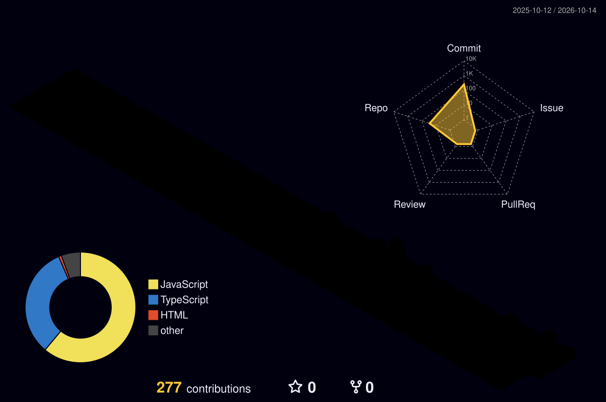

<!-- ===================== HEADER ===================== -->

  

 

 

<!-- ===================== ABOUT ===================== -->
## 👋 About Me

I'm a **full-stack developer** who builds complete web products — database schema, API, auth, payments and UI — and ships them live. I work at **[adEstra Solutions](https://www.adestrasolutions.com/)**, a digital agency in Dhaka, building web products for real clients.

My focus is the part most portfolios skip: **making apps safe to put in front of real users and real money.**

  

 

<!-- ===================== WHY WORK WITH ME ===================== -->
## 💼 What You Get Working With Me

<table>
<tr>
<td width="33%" valign="top" align="center">
<h3>🔐</h3>
<b>Security by default</b> 
Sessions verified in the database, roles enforced in Server Actions and API routes — not just hidden buttons.
</td>
<td width="33%" valign="top" align="center">
<h3>💳</h3>
<b>Payments that work</b> 
Stripe and SSLCommerz (bKash, Nagad, cards) with atomic transactions and duplicate-payment protection.
</td>
<td width="33%" valign="top" align="center">
<h3>🚀</h3>
<b>Shipped, not just coded</b> 
Every featured project is deployed and live — you can click through it right now.
</td>
</tr>
</table>

 

<!-- ===================== EXPERIENCE ===================== -->
## 🏢 Experience

**Full-Stack Developer** · [adEstra Solutions](https://www.adestrasolutions.com/) · Dhaka, Bangladesh · *Present*
> Building and maintaining client web products for a digital agency covering design, marketing and IT solutions.

**Independent Projects** · Full-Stack
> Designed and shipped a multi-vendor marketplace and a full e-commerce platform end to end — see below.

 

<!-- ===================== PROJECTS ===================== -->
## 🚀 Featured Projects

<table>
<tr>
<td width="50%" valign="top">

### 🛒 NexMart
**Multi-vendor marketplace** with server-verified security.

- Separate dashboards for **Shoppers, Sellers & Admins**
- **SSLCommerz** — bKash, Nagad, Visa, Mastercard — with atomic transactions + duplicate-payment guard
- **Better Auth** sessions stored in PostgreSQL; every route and Server Action checks the role on the server
- SSR-safe persistent cart, dark/light mode, responsive UI

`Next.js 16` `TypeScript` `Prisma` `PostgreSQL` `Tailwind v4`

</td>
<td width="50%" valign="top">

### 🎨 Craftora
**Full-stack e-commerce** with real-time admin analytics.

- Separate **User & Admin** experiences — products, cart, order tracking
- Role-based access control with **Better Auth**
- Live admin dashboard in **Recharts** — sales & order statistics
- Fully typed from database to UI with Prisma + TypeScript

`Next.js` `TypeScript` `Prisma` `PostgreSQL` `Recharts`

</td>
</tr>
</table>

 

<!-- ===================== TECH STACK ===================== -->
## 🧰 Tech Stack

<table>
  <tr>
    <td align="center" width="140"><b>Languages</b></td>
    <td></td>
  </tr>
  <tr>
    <td align="center"><b>Frontend</b></td>
    <td></td>
  </tr>
  <tr>
    <td align="center"><b>Backend</b></td>
    <td></td>
  </tr>
  <tr>
    <td align="center"><b>Databases</b></td>
    <td> 
      
      
    </td>
  </tr>
  <tr>
    <td align="center"><b>Auth</b></td>
    <td>
      
      
      
      
      
    </td>
  </tr>
  <tr>
    <td align="center"><b>Payments</b></td>
    <td>
      
      
      
    </td>
  </tr>
  <tr>
    <td align="center"><b>Cloud & Tools</b></td>
    <td> 
      
      
      
      
    </td>
  </tr>
  <tr>
    <td align="center"><b>Learning now</b></td>
    <td></td>
  </tr>
</table>

 

<!-- ===================== ACTIVITY ===================== -->
## 📊 GitHub Activity

<!-- 3D contribution city — generated daily by .github/workflows/profile-3d.yml -->
<picture>
  <source media="(prefers-color-scheme: dark)" srcset="./profile-3d-contrib/profile-night-rainbow.svg" />
  <source media="(prefers-color-scheme: light)" srcset="./profile-3d-contrib/profile-green-animate.svg" />
  
</picture>

  

 

 

<!-- ===================== EDUCATION ===================== -->
## 🎓 Learning Path

| Credential | Provider | Covers |
|---|---|---|
| Complete Web Development Course (Batch 12) | Programming Hero | HTML, CSS, JavaScript, React, Node.js, Express, MongoDB |
| In progress | Self-directed | NestJS, System Design, Docker & CI/CD |

 

<!-- ===================== CONTACT ===================== -->

## 🤝 Let's Work Together

**Hiring, or need a web app built?** I reply to every message.

  

